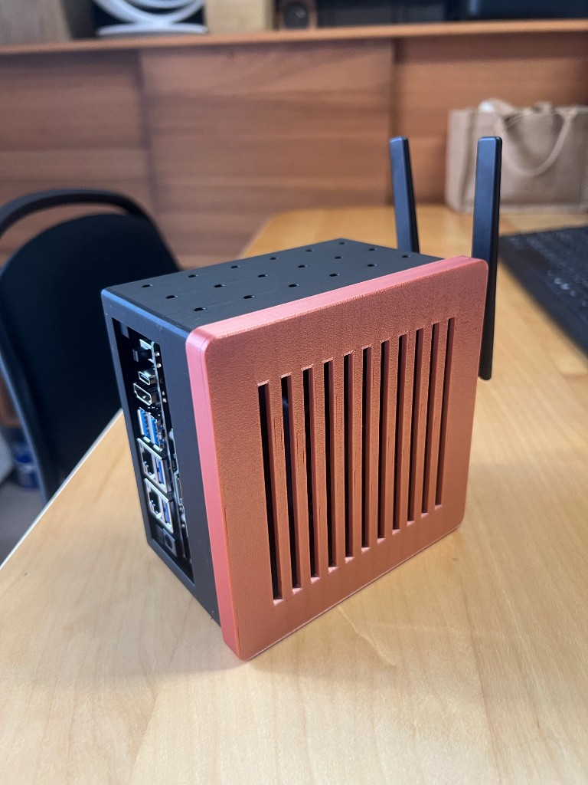
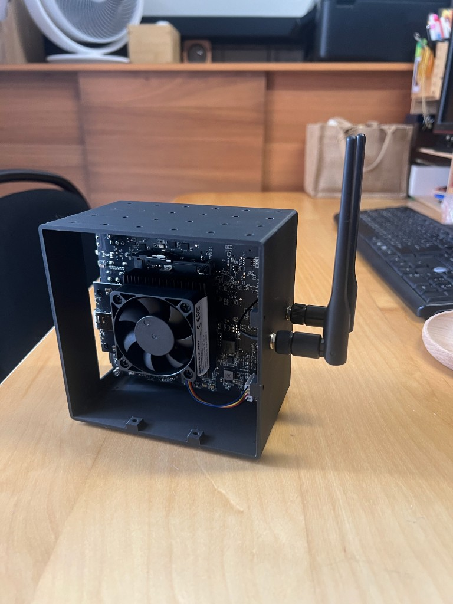
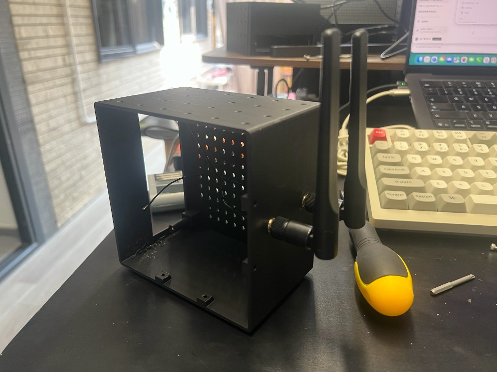
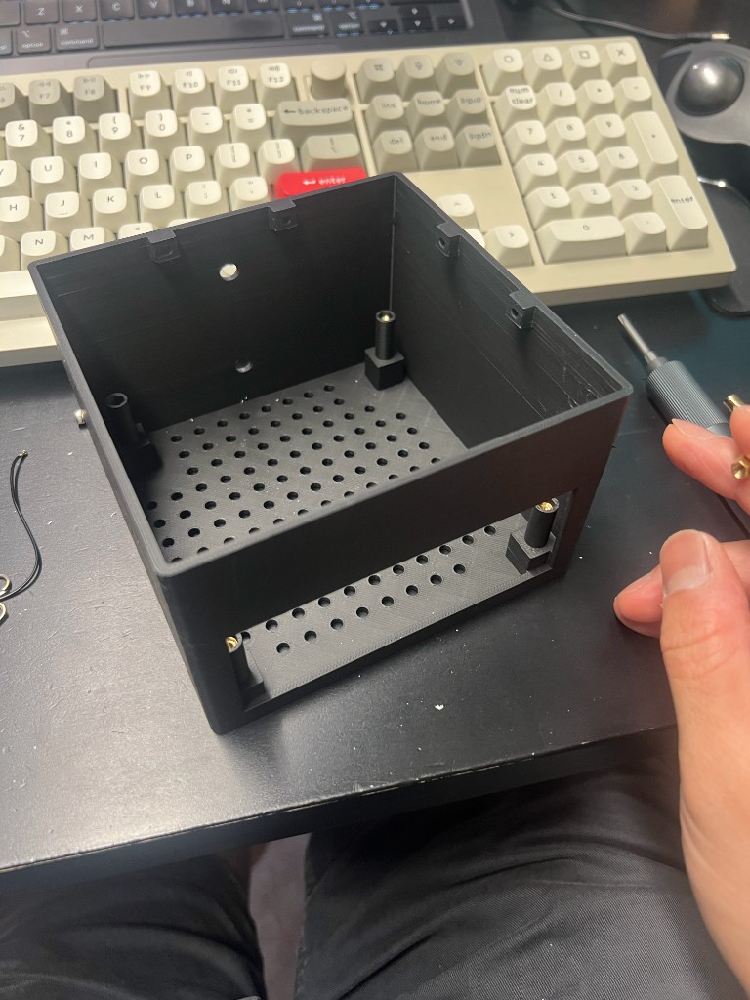
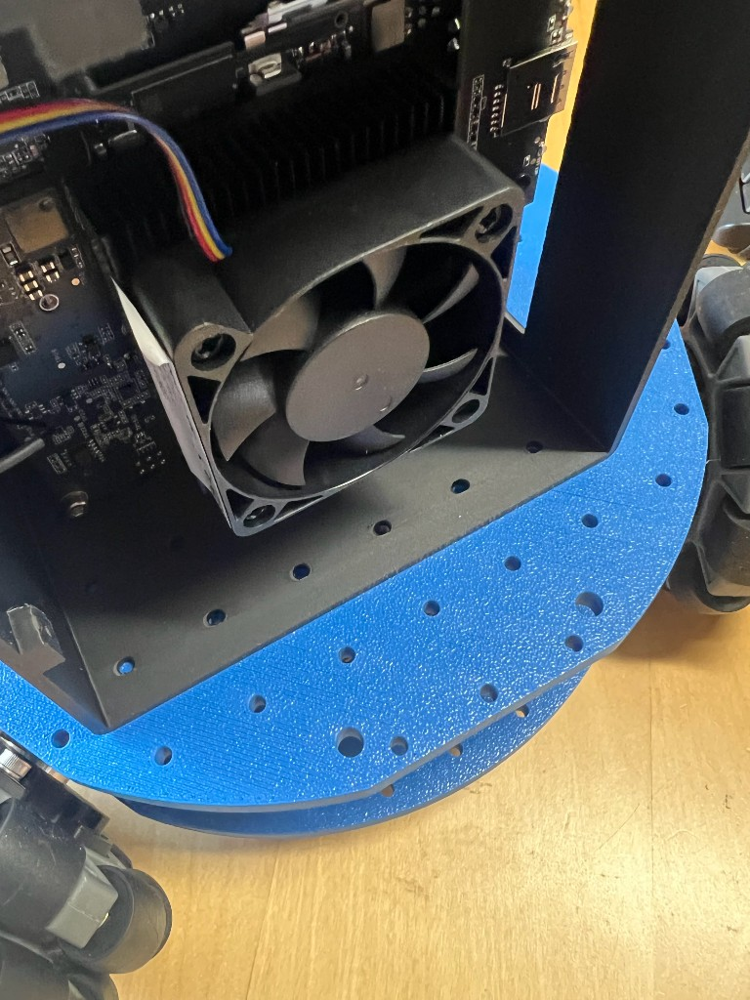
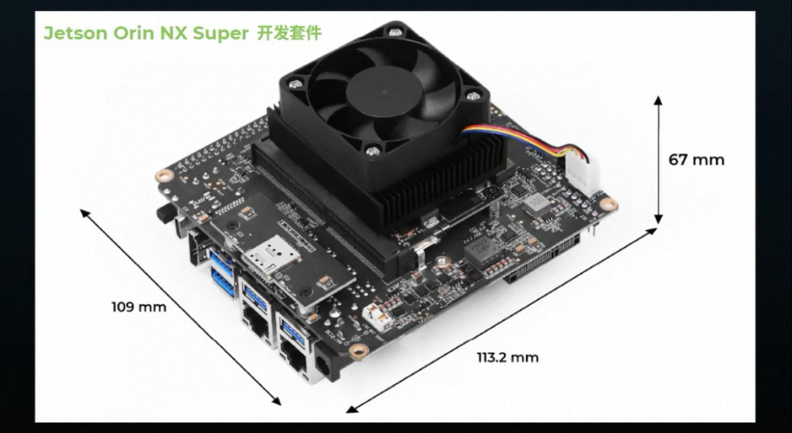

# Jetson Orin NX Super Case (Lekiwi Mount)

A 3D-printable protective case for the [Seeed Studio reComputer Jetson Orin NX Super](https://wiki.seeedstudio.com/recomputer_jetson_super_getting_started/) developer kit, with **dual usage**:

- **Desktop standing** — sits stably on a desk like a mini PC, with the IO side facing out.
- **Lekiwi robot mount** — flips over and bolts onto the **Lekiwi** robot platform via an M3 grid (20mm pitch) on the front wall.



The board this case is built around measures **113.2 x 109 x 67 mm** (L x W x H, including fan). The case inner volume is **120 x 120 x 75 mm** to give clearance around the fan, ports, and under-board components.

### Real-world photos


| Assembled (front)                    | IO side                        | Top (fan grill)                 |
| ------------------------------------ | ------------------------------ | ------------------------------- |
|  |  |  |


| Wifi Antenna Installed (can flip both side for both LeKiwi mount or Desktop standing) | Empty base (inserted hexagonal screw pillar) | Cover (top vents + fan grill)   |
| ------------------------------------------------------------------------------------- | -------------------------------------------- | ------------------------------- |
|                                        |     |  |


| Mountable on the Lekiwi baseboard          |
| ------------------------------------------ |
|  |


### Reference board dimensions



## Features

- **Dual usage**: desktop-standing on one side, Lekiwi robot mount on the other — flip the case to switch.
- **Two-piece design**: a `base` (board mounts to it) and a `cover` (sits on top with a skirt + 4 side screws).
- **Vertical board mount**: the board sits on 4 solid pillars and is clamped by M3 screws threading into brass hex columns. A long M3 screw from below locks each brass column against vertical lift (the "bottom anchor").
- **Lekiwi M3 grid** on the front wall (20mm pitch) for bolting the case to the Lekiwi chassis.
- **Ventilation**: round vent holes in the base, slot vents in the cover.
- **IO cutout** on the +X side for the USB / Ethernet / DC jack cluster.
- **Parametric OpenSCAD source** — every dimension is a variable at the top of the file, so you can tweak for a different board or mount.


## Bill of materials (quick)


| Qty | Item                                      | Notes                                                         |
| --- | ----------------------------------------- | ------------------------------------------------------------- |
| 4   | M3 brass hex column, ~22mm, double-female | Sits in the hex recess of each pillar                         |
| 4   | M3 screw, long (~30mm)                    | From below, threads into the brass column, locks it down      |
| 4   | M3 screw, short (~10mm)                   | Clamps the board to the pillar top, into the brass column top |
| 4   | M3 screw, short (~10mm)                   | Side screws for the cover                                     |
| 4   | M3 nut (or boss)                          | For the cover side screws, depending on your build            |


See [docs/bom.md](docs/bom.md) for the full list with dimensions and sourcing suggestions.

## Print settings (starting point)

These are a starting point, not a verified profile. Adjust for your printer and filament.

- **Material**: PLA or PETG (PETG recommended for higher ambient temps inside the case)
- **Layer height**: 0.2mm
- **Infill**: 30%
- **Walls**: 3 perimeters (the `wall = 2.5mm` parameter in the SCAD)
- **Supports**: **recommended** — the pillars and skirt print fine without supports, but the long horizontal bridge across the top edge of the IO fanout will sag / split like spaghetti without supports. Enable supports (or tree supports) for the base; the cover needs no supports.
- **Orientation**: print each STL flat on its bottom face as exported


## Files

- `[cad/Jetson_Orin_NX_Case.scad](cad/Jetson_Orin_NX_Case.scad)` — OpenSCAD source, parametric
- `[stl/base.stl](stl/base.stl)` — ready-to-print base
- `[stl/cover.stl](stl/cover.stl)` — ready-to-print cover
- `[bambu-studio/cover.3mf](bambu-studio/cover.3mf)` — Bambu Studio slicer project for the cover (includes print profile)
- `[scripts/build.sh](scripts/build.sh)` — renders the SCAD into the two STLs


## Quick start


### Just print it

1. Download `[stl/base.stl](stl/base.stl)` and `[stl/cover.stl](stl/cover.stl)`.
2. Import into Bambu Studio / OrcaSlicer / PrusaSlicer.
3. Print with the settings above.
4. Follow [docs/assembly.md](docs/assembly.md) to assemble.


### Rebuild the STLs from source

You need [OpenSCAD](https://openscad.org/) installed.

```bash
./scripts/build.sh            # render both base + cover into ./stl
./scripts/build.sh base       # render only the base
./scripts/build.sh cover      # render only the cover
./scripts/build.sh gui        # open the OpenSCAD GUI for editing
```

On Apple Silicon with the Homebrew `openscad@snapshot` cask, the script auto-uses Rosetta for the x86_64 slice (the arm64 Qt slice is broken in some snapshot builds). Set `USE_ROSETTA=0` to disable, or `USE_ROSETTA=1` to force.

## Assembly

See [docs/assembly.md](docs/assembly.md) for the step-by-step assembly, including the pillar / brass-column / bottom-anchor mechanism.

## License

- **Hardware** (the OpenSCAD source and the STL files): [CERN-OHL-S v2](LICENSE).
- **Build script** (`scripts/build.sh`): [MIT](LICENSE-MIT).

In short: you can build, modify, and redistribute this case freely, but derivatives of the hardware must be released under the same CERN-OHL-S v2 license, and you must credit the original project.

## Acknowledgements

- Board dimensions and IO layout from the [Seeed Studio reComputer Jetson Orin NX Super getting-started guide](https://wiki.seeedstudio.com/recomputer_jetson_super_getting_started/).
- Designed for the Lekiwi robot platform.

