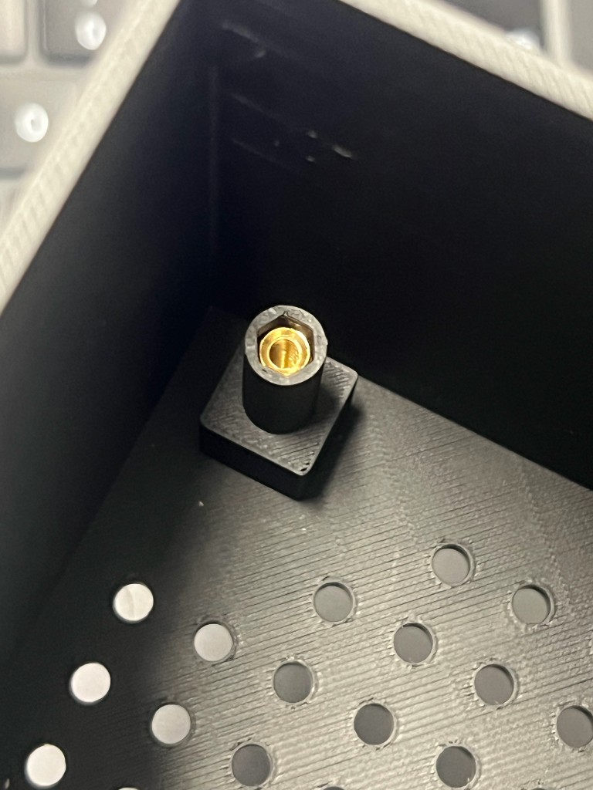
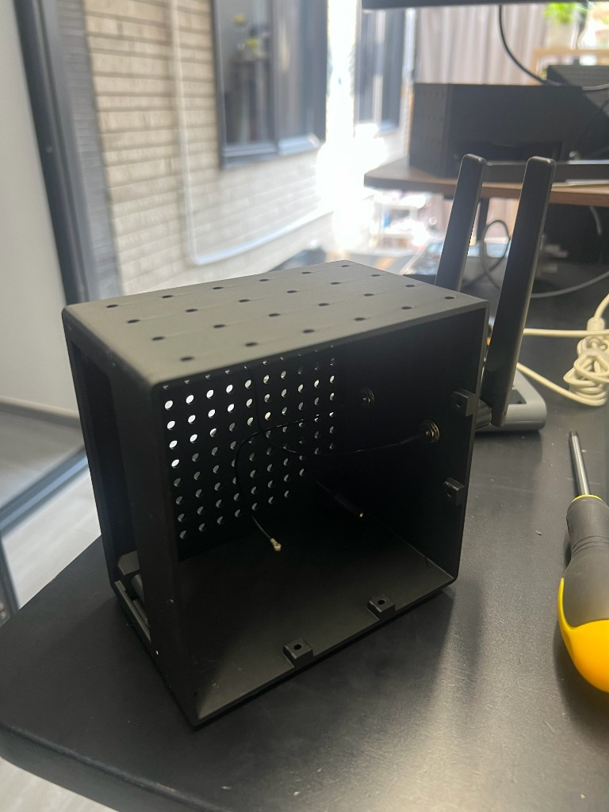
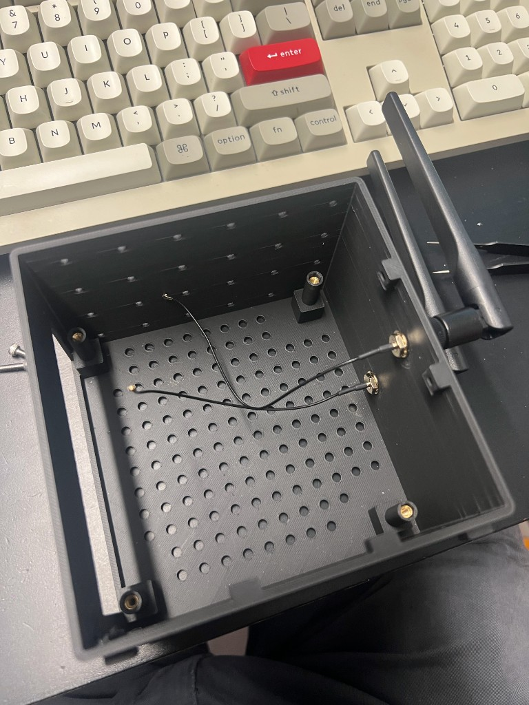
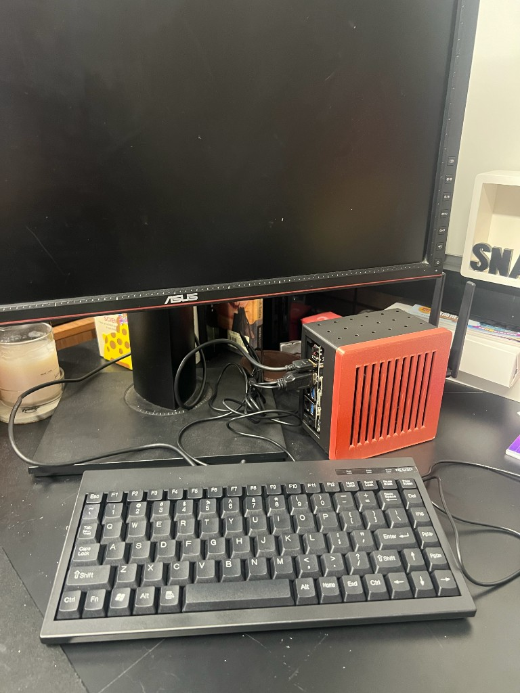
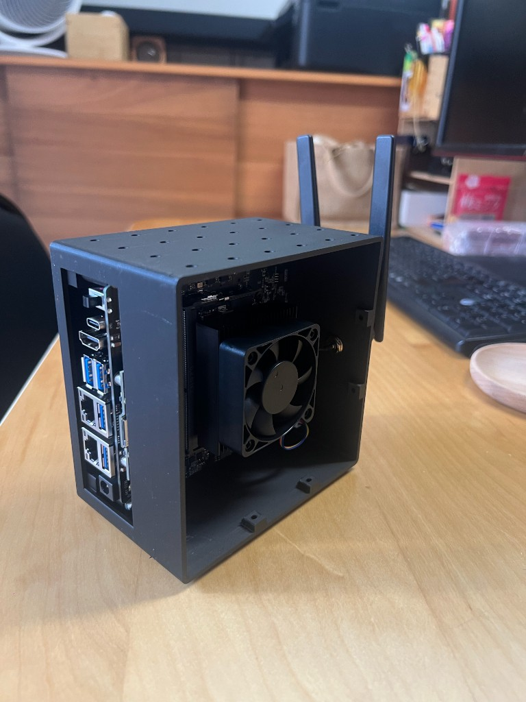

# Assembly Guide

This guide walks through assembling the Jetson Orin NX Super case. The design uses a **pillar + brass hex column + bottom-anchor screw** mechanism so the board is locked vertically and laterally without any glue.

## Orientation

The case sits **flat** on its **floor** (the face with the grid of small round vent holes). The **cover** (the face with the long rectangular vent slots) is the **top**. The four vertical walls are the sides:

- **IO wall** (+X, x = 125) — the wide rectangular cutout for USB / Ethernet / DC jack
- **Antenna wall** (-X, x = 0) — the two round holes for the WiFi antenna SMA bulkheads
- **Lekiwi mount wall** (-Y, y = 0) — the M3 grid of pilot holes (20mm pitch) for bolting to the Lekiwi chassis
- **Screw wall** (+Y, y = 125) — the 2 side screw bosses that mate with the cover

The case can also stand **vertically** on the +Y wall using the 4 feet (foot_s × foot_h) on that face.

## Parts you need

See [bom.md](bom.md). In short:

- 1x printed `base`
- 1x printed `cover`
- 4x M3 brass hex columns (~22mm, 5mm across flats, **double-female**)
- 4x long M3 screws (~30mm, from below, to anchor the columns)
- 4x medium M3 screws (~10–12mm, from top, to clamp the board)
- 4x short M3 screws (~10mm, for the cover sides)
- 2x WiFi antenna pigtails with SMA bulkhead connectors + nuts + washers
- 1x Jetson Orin NX Super board

## Step 1: Install the brass columns into the base

Each of the 4 pillars in the base has a deep hex recess (22mm) sized for a 5mm across-flats brass hex column.

1. Drop a brass hex column into each pillar's recess, hex-end down. The hex shape prevents it from rotating once seated.
2. The column should sit flush with the top of the slimmed pillar section. If it sits proud, the column is too long; if it sits deep, it's too short. Adjust by changing `hex_depth` in the SCAD and re-rendering if needed.

## Step 2: Lock the columns from below (the bottom anchor)

1. Flip the base over so the floor (vent-grid side) faces up.
2. From the bottom of the base, insert a long M3 screw through the counterbore under each pillar. The screw head sits in the counterbore (flush with or slightly below the bottom of the base).
3. Thread the screw up into the lower end of the brass hex column.
4. Tighten. This pulls the brass column **down** against the recess floor and locks it against vertical lift. Do all 4.

At this point the brass columns are permanently locked into the base and cannot fall out or push up.

## Step 3: Secure the WiFi antennas to the antenna wall

Do this **before** mounting the board — once the board is in, it blocks access to the antenna nuts on the inside of the antenna wall.

The antenna wall (-X, x = 0) has two round holes (`ant_d = 7mm`) at `y = 60`, `z = 20` (low) and `z = 60` (high).

1. From the **inside** of the case, pass each antenna's SMA bulkhead connector out through one of the two holes in the antenna wall.
2. On the **inside**, fit a washer over the connector and tighten the hex nut. This clamps the connector to the wall.

1. On the **outside**, screw the paddle antenna onto the bulkhead connector.
2. Route the two pigtail cables (U.FL end) into the case — they will plug onto the board's WiFi connectors later.

## Step 4: Mount the board

1. Orient the Jetson Orin NX Super board so the IO edge (USB / Ethernet / DC jack) aligns with the IO cutout on the +X wall of the base.
2. Lower the board onto the 4 slimmed pillar tops. The 4 mounting holes in the board should land on the 4 brass column tops.
3. From the top, insert a medium M3 screw through each board mounting hole and thread it into the brass column.
4. Tighten gradually in an X pattern (1 -> 3 -> 2 -> 4) to seat the board evenly. The screw head clamps the board down onto the pillar top.
5. Plug the two antenna pigtails onto the board's U.FL WiFi connectors.

The board is now locked vertically (between the pillar top and the screw head) and laterally (by the 4 pillar tops).

## Step 5: Attach the cover

The cover is exported **print-oriented** (flipped, plate down, skirt up) so it prints without supports. To assemble, flip it back **front-to-back** (180° around the X axis) so the plate is on top and the skirt hangs down around the base.

1. Flip the printed cover front-to-back. The plate is now on top, the skirt points down.
2. Place the cover over the base. The skirt drops down around the outside of the base with a small fit clearance (`fit_clear = 0.2mm`).
3. Align the 2 side screw holes in the cover skirt with the 2 bosses on the +Y wall of the base (at X = 40 and X = 80), and the 2 holes on the -X wall of the cover with the 2 bosses on the -X wall of the base (at Y = 40 and Y = 80).
  - The cover's screw holes are pre-mirrored in the SCAD so that after the print flip they land on the base's +Y and -X bosses.
4. Drive a short M3 screw through each cover-side hole into the base boss.
5. Tighten. The cover is now clamped to the base.

> **Flip direction matters.** Always flip front-to-back (around the X axis). If you flip left-to-right (around the Y axis) instead, the screw holes will land on the wrong walls.

## Step 6 (Optional) : Mount to the Lekiwi

The Lekiwi mount wall (-Y, the wall without the IO cutout, opposite the antenna wall) has an M3 grid of pilot holes at 20mm pitch. Use these to bolt the assembled case to the Lekiwi chassis with user-supplied M3 hardware that matches your Lekiwi's mounting pattern.

## Disassembly

- To remove the cover: unscrew the 4 side screws and lift.
- To remove the board: unplug the antenna pigtails, then unscrew the 4 top screws and lift the board.
- To remove the brass columns: unscrew the 4 bottom anchor screws from below, then push the columns up out of the recess.

## Tips

- **Print the base floor-down (vent grid on the bed).** Supports needed for the IO cutout. 
- If the M3 pilot holes are too tight (printer-dependent), run a 2.5mm or 3mm drill bit through them by hand.
- If the cover skirt is too tight on the base, increase `fit_clear` in the SCAD and re-render.
- If the antenna holes are too tight for the SMA bulkhead, increase `ant_d` in the SCAD and re-render.
- The IO cutout is sized for the reComputer Jetson Orin NX Super IO cluster. If you are using a different carrier board, adjust `io_w`, `io_h`, and `io_z0` in the SCAD.

## Finished builds

